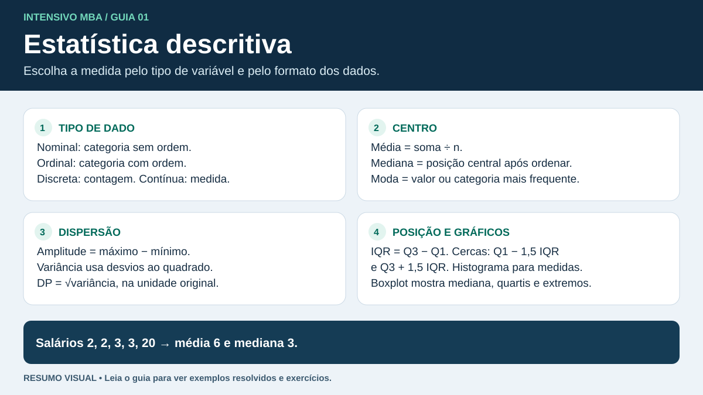

# Estatística descritiva

**Para a prova.** Identifique o tipo de dado, leia o denominador antes de calcular uma frequência, escolha uma medida que represente a distribuição e interprete gráficos com unidades e contexto. Pearson e qui-quadrado respondem a perguntas diferentes sobre associação.

## 1. Dados e tabelas

| Conceito | Como reconhecer | Exemplo |
|---|---|---|
| População e parâmetro | Conjunto de interesse e medida desse conjunto | Prazo médio de todas as entregas do trimestre |
| Amostra e estatística | Subconjunto observado e medida calculada nele | Prazo médio de 100 entregas selecionadas |
| Qualitativa nominal | Categorias sem ordem | Região, tipo de veículo |
| Qualitativa ordinal | Categorias ordenadas | Avaliação ruim, regular, boa |
| Quantitativa discreta | Contagem de valores separados | Número de avarias |
| Quantitativa contínua | Medida em uma escala contínua | Peso, distância, tempo de trânsito |

O código de rota 123 identifica uma categoria nominal. A escala ordinal permite ordenar categorias. A distância entre “ruim” e “regular” pode diferir da distância entre “regular” e “boa”. Uma amostra grande pode continuar enviesada se a coleta excluir parte da população.

| Atraso em horas | Frequência absoluta | Frequência relativa | Frequência acumulada |
|---|---:|---:|---:|
| 0 a menos de 2 | 6 | 30% | 6 |
| 2 a menos de 4 | 9 | 45% | 15 |
| 4 a menos de 6 | 5 | 25% | 20 |

- Frequência relativa = frequência da classe ÷ total. A segunda faixa contém 9/20 = 45% das observações.
- A frequência acumulada usa classes ordenadas. Abaixo de 4 h estão 15 entregas, ou 75%.
- A classe modal é a de 2 a menos de 4 h para esses intervalos de mesma largura. A tabela agrupada identifica a classe, mas perdeu os valores individuais.
- Com classes de larguras diferentes, um histograma cuja **área** representa frequência usa altura proporcional a frequência ÷ largura.

## 2. Centro e dispersão

| Medida | Cálculo | Interpretação |
|---|---|---|
| Média | $\bar{x}=\sum_i x_i/n$ | Centro aritmético. Valores extremos podem deslocá-la bastante. |
| Média ponderada | $\sum_i w_ix_i/\sum_i w_i$ | Cada valor contribui conforme seu peso. Use os tamanhos dos grupos ao reunir suas médias. |
| Mediana | Ordene. Pegue o centro, ou a média dos dois valores centrais se $n$ for par. | Divide a lista ordenada ao meio. É resistente a extremos. |
| Moda | Valor de maior frequência | Pode haver empate no topo. Para variável nominal, descreve a categoria mais frequente. |
| Amplitude | $\max(x)-\min(x)$ | Depende só dos extremos. |
| Variância populacional | $\sigma^2=\sum_i(x_i-\mu)^2/N$ | Média dos desvios quadráticos na população. |
| Variância amostral | $s^2=\sum_i(x_i-\bar{x})^2/(n-1)$ | Com amostragem independente, estima a variância populacional sem viés. Requer $n\geq2$. |
| Desvio padrão | $s=\sqrt{s^2}$ | Dispersão na unidade original. Variância tem unidade ao quadrado. |
| Coeficiente de variação | $CV=s/\bar{x}$, em % se multiplicado por 100 | Compara dispersão relativa em escalas de razão com média positiva e longe de zero. |

**Exemplo.** Nos tempos de entrega $2, 3, 3, 4, 18$ h, média = 6 h, mediana = 3 h, moda = 3 h e amplitude = 16 h. A soma dos desvios quadráticos em torno de 6 é $16+9+9+4+144=182$. Se forem toda a população, variância = $182/5=36{,}4$ h² e desvio padrão ≈ 6,03 h. Se forem uma amostra, variância amostral = $182/4=45{,}5$ h² e desvio padrão ≈ 6,75 h. A cauda à direita ajuda a explicar a média acima da mediana neste exemplo.

**Reescala.** Para $Y=a+bX$, $\bar y=a+b\bar x$, $s_Y=|b|s_X$ e $s_Y^2=b^2s_X^2$. Converter horas em minutos multiplica o desvio padrão por 60. Somar 15 min a cada observação muda o centro e preserva o desvio padrão.

**Média de grupos.** Uma frota de 10 entregas com média 2 h e outra de 30 com média 4 h têm média combinada $(10\times2+30\times4)/40=3{,}5$ h.

## 3. Quartis, percentis e outliers

- $Q_1=P_{25}$, $Q_2=P_{50}$ (mediana), $Q_3=P_{75}$. O percentil 90 é um limiar de posição que deixa aproximadamente 90% das observações em ou abaixo dele, conforme o método e os empates.
- $AIQ=Q_3-Q_1$ mede a extensão dos 50% centrais. A regra de Tukey sinaliza pontos estritamente abaixo de $Q_1-1{,}5\,AIQ$ ou acima de $Q_3+1{,}5\,AIQ$.
- No boxplot de Tukey, os bigodes vão até os valores observados mais extremos **dentro** das cercas. Pontos fora delas aparecem separados.
- Métodos de interpolação e de divisão das metades podem produzir quartis diferentes em amostras pequenas. Siga a convenção fornecida no exercício.
- Um outlier merece investigação. Pode ser erro de registro ou evento real relevante.

**Exemplo.** Para $1, 2, 3, 4, 5, 6, 7, 24$, use a mediana de cada metade. $Q_1=2{,}5$, $Q_2=4{,}5$ e $Q_3=6{,}5$. AIQ = 4, cercas = −3,5 e 12,5, bigodes = 1 e 7. O 24 aparece separado.

## 4. Escolha e leitura de gráficos

| Pergunta | Visual | O que observar |
|---|---|---|
| Qual categoria tem maior frequência? | Barras | Categorias, denominador das proporções, base do eixo |
| Como se distribui uma medida contínua? | Histograma | Caudas, modas e largura das classes |
| Como comparar centro e dispersão entre grupos? | Boxplots paralelos | Medianas, AIQ, extensão dos bigodes e outliers |
| Duas medidas variam juntas? | Dispersão | Direção, curvatura, grupos e pontos influentes |
| Como a medida evolui no tempo? | Linhas em ordem temporal | Tendência, sazonalidade e mudanças de nível |

## 5. Associação

**Pearson.** Para duas variáveis quantitativas não constantes, $r=\mathrm{cov}(X,Y)/(s_Xs_Y)$, com a mesma convenção de denominador. Varia de −1 a 1 e resume direção e força **linear**. Um valor próximo de zero pode coexistir com relação curva. Outliers podem dominar o resultado. Associação pode refletir uma terceira variável. Na regressão linear simples com intercepto, $R^2=r^2$.

**Qui-quadrado de independência.** Para duas variáveis categóricas, organize as contagens observadas $O_{ij}$ em tabela de contingência. Sob independência, $E_{ij}=(\text{total da linha})(\text{total da coluna})/n$. Calcule $\chi^2=\sum_{i,j}(O_{ij}-E_{ij})^2/E_{ij}$ com $(L-1)(C-1)$ graus de liberdade. A aproximação depende de frequências esperadas adequadas e observações independentes. Em uma tabela 2×2 muito esparsa, o teste exato de Fisher é uma alternativa.

**Exemplo.** Na rota A, 12 de 20 entregas atrasaram. Na B, 8 de 20 atrasaram. Sob independência, esperam-se 10 atrasadas e 10 pontuais por rota. Sem correção de continuidade, $\chi^2=4(2^2/10)=1{,}6$, com 1 grau de liberdade. O p-valor é aproximadamente 0,206. A 5%, a amostra oferece evidência insuficiente para rejeitar a independência. As frequências esperadas são contagens previstas pela hipótese, não as proporções observadas.

## Checagem antes de avançar

1. Uma única entrega passou de 7 h para 35 h e já era a mais demorada. O que acontece com a média, a amplitude e a mediana de um conjunto de nove entregas?
2. Das 100 viagens, 30 levaram menos de 1 h, 40 ficaram de 1 a menos de 2 h e 30 duraram pelo menos 2 h. Qual é a frequência acumulada abaixo de 2 h?
3. Qual técnica distingue uma relação **linear** entre distância e tempo? Qual testa independência entre turno e ocorrência de avaria?

Respostas comentadas

1. A média aumenta em 28/9 h, a amplitude aumenta 28 h e a mediana permanece igual.
2. 70 viagens, ou 70%.
3. Correlação de Pearson para duas medidas quantitativas. Qui-quadrado de independência para as duas categorias, dadas as condições de aplicação.

