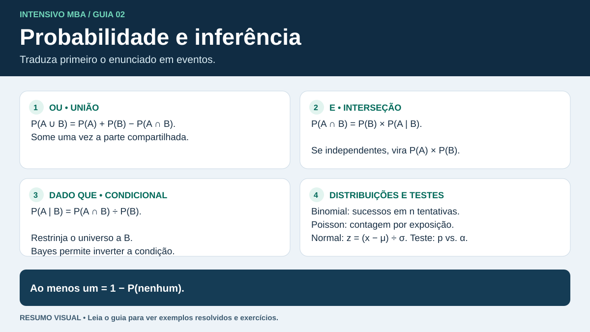

# Probabilidade

**Para a prova.** Traduza o texto para eventos, verifique qual universo entra no denominador e escolha a regra antes de calcular. Essa base reaparece em regressão logística, modelos de contagem e classificação.

## 1. Vocabulário e regras

O espaço amostral $\Omega$ reúne resultados possíveis. Um evento $A$ é um subconjunto de $\Omega$. A razão “casos favoráveis ÷ casos possíveis” vale quando os resultados elementares são equiprováveis.

| Expressão no enunciado | Evento e regra |
|---|---|
| Nenhum, falha de A, A não ocorre | $P(A^c)=1-P(A)$ |
| A ou B, incluindo ambos | $P(A\cup B)=P(A)+P(B)-P(A\cap B)$ |
| A e B | $P(A\cap B)=P(A\mid B)P(B)$ |
| A, dado que B ocorreu | $P(A\mid B)=P(A\cap B)/P(B)$, se $P(B)>0$ |
| Pelo menos um | $1-P(\text{nenhum})$ |
| Exatamente um entre A e B | $P(A)+P(B)-2P(A\cap B)$ |

**Mutuamente exclusivos.** A e B não podem ocorrer juntos, então $P(A\cap B)=0$. **Independentes.** A ocorrência de um não altera a probabilidade do outro, então $P(A\cap B)=P(A)P(B)$. Eventos mutuamente exclusivos com probabilidades positivas são dependentes.

**Exemplo.** Entre 100 entregas, 30 tiveram atraso, 20 tiveram reentrega e 10 tiveram ambos. $P(\text{atraso ou reentrega})=(30+20-10)/100=40\%$. $P(\text{atraso}\mid\text{reentrega})=10/20=50\%$, enquanto $P(\text{reentrega}\mid\text{atraso})=10/30\approx33{,}3\%$. Atraso e reentrega são dependentes, pois $10\%\ne30\%\times20\%$.

## 2. Árvore, probabilidade total e Bayes

Na árvore, **multiplique** ao longo de um caminho e **some** caminhos que representam possibilidades disjuntas do evento. Se as categorias $B_i$ formam uma partição de $\Omega$:

- Probabilidade total $P(A)=\sum_i P(A\mid B_i)P(B_i)$.
- Bayes $P(B_j\mid A)=P(A\mid B_j)P(B_j)/P(A)$.

**Exemplo.** A filial Norte responde por 80% do volume, com 5% de atrasos. A Sul responde por 20%, com 15% de atrasos.

1. Norte e atraso $=0{,}80\times0{,}05=0{,}04$.
2. Sul e atraso $=0{,}20\times0{,}15=0{,}03$.
3. Atraso total $=0{,}04+0{,}03=0{,}07$.
4. Sul **entre as atrasadas** $=0{,}03/0{,}07\approx42{,}86\%$.

Imagine 100 entregas para conferir o denominador. Das sete atrasadas, três vieram da Sul. Os 15% iniciais referem-se às entregas da Sul. Os 42,86% referem-se a todas as atrasadas.

## 3. Contagem e amostragem

| Situação com itens distintos | Fórmula |
|---|---|
| Escolhas sucessivas com $a$ opções na primeira etapa e $b$ em cada segunda etapa | $a\times b$ |
| Ordenar $n$ itens | $n!$ |
| Escolher e ordenar $k$ entre $n$, sem reposição | $n!/(n-k)!$ |
| Escolher $k$ entre $n$, sem reposição e sem ordem | $\binom nk=n!/[k!(n-k)!]$ |
| Escolher $k$ vezes entre $n$ opções com reposição e com ordem | $n^k$ |

**Exemplo.** De cinco veículos, dois são elétricos. Escolha dois ao acaso sem reposição. Para saírem ambos elétricos, $P=(2/5)(1/4)=1/10$. Pelo método de combinações, há uma dupla favorável entre $\binom52=10$. Se cada sorteio for independente com reposição, a chance vira $(2/5)^2=4/25$.

## 4. Variáveis aleatórias e distribuições

| Modelo | Use quando | Fórmula ou propriedade |
|---|---|---|
| Bernoulli | Uma tentativa, dois resultados codificados em 0 e 1 | $E[X]=p$, $\operatorname{Var}(X)=p(1-p)$ |
| Binomial | $n$ tentativas independentes, com probabilidade de sucesso $p$ constante | $P(X=k)=\binom nkp^k(1-p)^{n-k}$. Média $np$, variância $np(1-p)$. |
| Hipergeométrica | Número de sucessos em $n$ itens sorteados sem reposição de $N$, com $K$ itens favoráveis | $P(X=k)=\binom Kk\binom{N-K}{n-k}/\binom Nn$ |
| Poisson | Contagem em uma janela com taxa constante e ocorrências independentes em intervalos disjuntos | $P(X=k)=e^{-\lambda}\lambda^k/k!$. Média e variância = $\lambda$. |
| Normal | Medida contínua modelada com densidade simétrica, média $\mu$ e desvio padrão $\sigma>0$ | $Z=(X-\mu)/\sigma$. Probabilidade de intervalo é área sob a curva. |

Para variável discreta, $E[X]=\sum_x xP(X=x)$ e $\operatorname{Var}(X)=E[X^2]-E[X]^2$. O valor esperado pode cair entre valores possíveis. Para variável contínua com densidade, a probabilidade de um valor pontual é zero. A regra aproximada **68–95–99,7%** vale para intervalos a 1, 2 e 3 desvios padrão da média **sob a distribuição normal**.

**Exemplo binomial.** Com risco independente de atraso de 10% em cada uma de quatro entregas, a chance de exatamente uma atrasar é $4(0{,}1)(0{,}9)^3=29{,}16\%$. A chance de pelo menos uma atrasar é $1-0{,}9^4=34{,}39\%$. O primeiro resultado exclui cenários com dois ou mais atrasos.

**Exemplo Poisson.** Se a média é de dois chamados por hora e o modelo vale, em meia hora $\lambda=1$. A chance de pelo menos um chamado é $1-e^{-1}\approx63{,}2\%$. Ajuste $\lambda$ à janela da pergunta. Se a variância condicional for muito maior que a média, investigue superdispersão ao modelar a contagem.

**Exemplo normal.** Se o tempo segue uma normal com média 50 min e desvio padrão 10 min, 60 min está em $z=1$. A chance de passar de 60 min é aproximadamente 15,9%.

## Checagem antes de avançar

1. Dois eventos têm probabilidades 0,4 e 0,5, com interseção 0,2. São independentes? Qual é a chance da união?
2. 10% das cargas vêm da frota X. Avarias ocorrem em 8% das cargas X e 2% das demais. Qual a chance de uma carga avariada vir da frota X?
3. Em três inspeções independentes, a chance de detectar uma falha em cada inspeção é 20%. Qual é a chance de pelo menos uma detecção?
4. Uma janela de três horas tem média de seis incidentes em um processo de Poisson homogêneo. Qual é a chance de zero incidentes em meia hora?

Respostas comentadas

1. Sim, pois $0{,}4\times0{,}5=0{,}2$. A união tem chance $0{,}4+0{,}5-0{,}2=0{,}7$.
2. Use $P(X\mid\text{avaria})=0{,}008/(0{,}008+0{,}018)\approx30{,}77\%$.
3. Pelo complemento, $1-0{,}8^3=48{,}8\%$.
4. A média é 2 por hora e $\lambda=1$ na meia hora. Logo, $P(X=0)=e^{-1}\approx36{,}8\%$.

