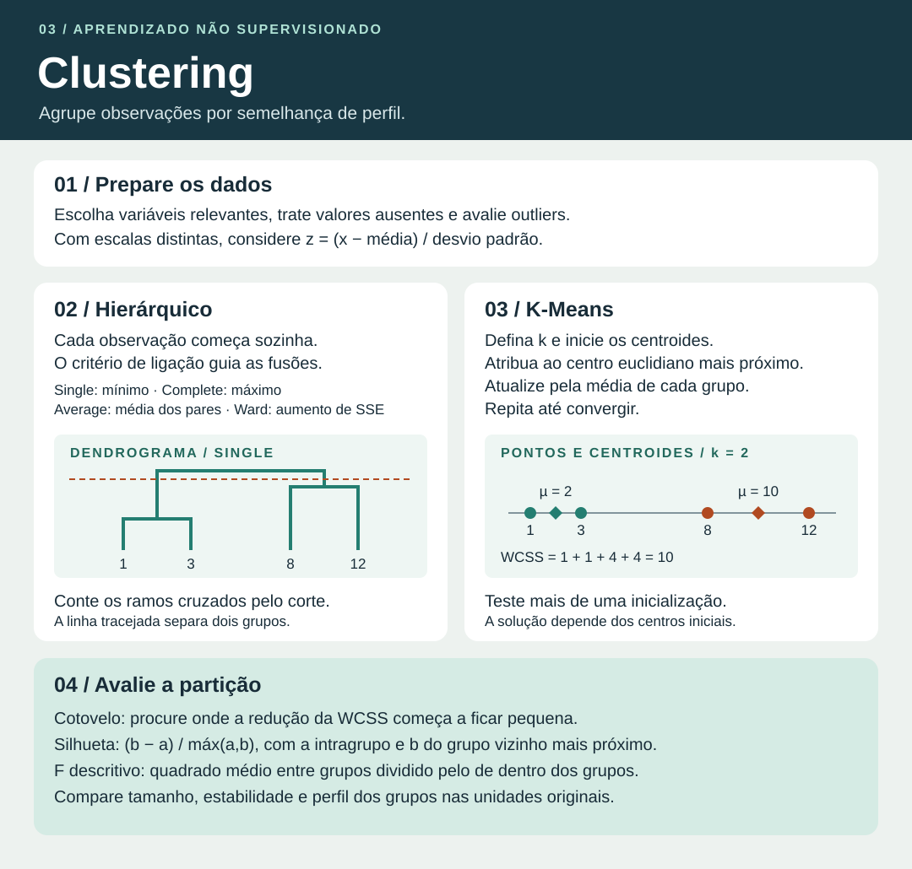

# Clustering · agrupamento hierárquico e K-Means

Clustering é uma técnica de **aprendizado não supervisionado** que reúne observações com perfis semelhantes segundo as variáveis e a medida de dissimilaridade escolhidas. Por exemplo, transportadoras podem agrupar rotas por distância, tempo de trânsito e frequência de atrasos. O resultado depende da definição de semelhança. Cada número de cluster é apenas um identificador.

## 1. Variáveis, escala e distância

1. Defina a unidade de análise. Uma linha pode representar uma rota, um cliente ou uma entrega.
2. Escolha variáveis que representem o perfil que você quer identificar. Trate faltantes, verifique outliers e evite contar duas vezes a mesma informação com variáveis muito redundantes.
3. Se as unidades ou magnitudes forem muito diferentes, avalie a padronização. O escore z é $(x-\bar x)/s$, com média e desvio padrão calculados para cada variável. Variáveis constantes não ajudam a separar observações.
4. Escolha uma distância compatível com os dados. A distância euclidiana é comum para variáveis numéricas. Para dados mistos, uma medida como Gower pode ser adequada com um método compatível.

| Medida | Fórmula para observações $x$ e $y$ | Intuição |
| --- | --- | --- |
| Euclidiana | $\sqrt{\sum_j (x_j-y_j)^2}$ | Caminho em linha reta. |
| Euclidiana quadrática | $\sum_j (x_j-y_j)^2$ | Soma das diferenças ao quadrado, como na função objetivo do K-Means. |
| Manhattan | $\sum_j \lvert x_j-y_j\rvert$ | Soma do deslocamento absoluto em cada eixo. |
| Chebyshev | $\max_j\lvert x_j-y_j\rvert$ | Maior deslocamento entre todos os eixos. |
| Canberra | $\sum_j \frac{\lvert x_j-y_j\rvert}{\lvert x_j\rvert+\lvert y_j\rvert}$ | Soma das diferenças relativas à magnitude. O termo vale zero se ambas as coordenadas forem zero. |

Para $x=(1,2)$ e $y=(4,6)$, a distância euclidiana é $\sqrt{3^2+4^2}=5$, a quadrática é 25, a Manhattan é $3+4=7$, a Chebyshev é 4 e a Canberra é $3/5+4/8=1{,}1$. Imagine agora uma variável em reais com diferenças de milhares e uma taxa em proporções. Sem ajuste de escala, a primeira tende a dominar a distância.

A correlação de Pearson entre perfis mede **semelhança** na forma da variação. Quando definida, pode virar dissimilaridade pela transformação $1-r$. Quanto maior $r$, mais próxima de zero fica a dissimilaridade.

## 2. Agrupamento hierárquico aglomerativo

Cada observação começa como um grupo. Em cada etapa, fundem-se dois grupos segundo o critério de ligação (*linkage*). As fusões anteriores permanecem na árvore. O método divisivo segue o sentido oposto e parte de um grupo para subdividi-lo.

Para $n$ observações, o processo completo com fusões duas a duas tem $n-1$ fusões. No *average linkage*, após unir $A$ e $B$, a distância a um terceiro grupo $C$ é $(n_A d(A,C)+n_B d(B,C))/(n_A+n_B)$. A média simples das duas distâncias equivale a essa fórmula quando $A$ e $B$ têm o mesmo tamanho.

| Ligação | Critério para fundir dois grupos | Efeito típico |
| --- | --- | --- |
| Single (*vizinho mais próximo*) | Menor distância entre um membro de cada grupo. | Pode formar cadeias ligadas por pontos intermediários. |
| Complete (*vizinho mais distante*) | Maior distância entre um membro de cada grupo. | Favorece grupos mais compactos. |
| Average | Média das distâncias de todos os pares entre os dois grupos. | Usa o conjunto dos pares. |
| Ward | Menor aumento da soma dos quadrados dentro dos grupos. | Favorece grupos compactos em geometria euclidiana. |

Em Ward, o aumento para grupos $A$ e $B$ é $\frac{n_A n_B}{n_A+n_B}\|\bar x_A-\bar x_B\|^2$. A altura exibida pode seguir uma transformação desse custo, dependendo do programa.

### Exemplo resolvido

Em uma dimensão, considere $A=1$, $B=3$, $C=8$ e $D=12$. O primeiro par fundido em *single*, *complete* e *average* é $\{A,B\}$, pois $d(A,B)=2$ é a menor distância. Depois da fusão, a distância entre $\{A,B\}$ e $C$ é:

- *Single*: $\min(7,5)=5$.
- *Complete*: $\max(7,5)=7$.
- *Average*: $(7+5)/2=6$.

Como $d(C,D)=4$, os três critérios unem $C$ e $D$ na segunda etapa. A altura da fusão final depende do *linkage*: 5 para *single*, 11 para *complete* e 8 para *average*.

### Como ler o dendrograma

- **Folhas** representam observações. A ordem horizontal pode mudar quando um ramo gira, preservando as fusões.
- **Altura de uma junção** representa o valor do critério de fusão naquela etapa.
- **Corte horizontal** define a partição. Conte os ramos interceptados. No exemplo, um corte na altura 4,5 produz dois grupos.
- Um salto vertical sugere uma faixa para investigar cortes. Compare a estabilidade, os tamanhos e a interpretação dos grupos.

## 3. K-Means

O K-Means recebe $k$, o número de grupos. O centro de cada grupo é a **média vetorial** dos pontos atribuídos a ele. O algoritmo busca reduzir a inércia, também chamada de soma dos quadrados intragrupos (WCSS ou SSE).

$$
\mathrm{WCSS}=\sum_{g=1}^{k}\sum_{x_i\in C_g}\|x_i-\mu_g\|_2^2
$$

1. Inicialize $k$ centroides. K-Means++ espaça os centros iniciais de forma probabilística.
2. Atribua cada observação ao centro euclidiano mais próximo.
3. Atualize cada centro com a média das observações atribuídas.
4. Repita as etapas 2 e 3 até a convergência ou o limite de iterações.

### Exemplo resolvido

Para os valores $1,3,8,12$ e centros iniciais 1 e 8, a primeira atribuição forma $\{1,3\}$ e $\{8,12\}$. Os centros atualizados são $(1+3)/2=2$ e $(8+12)/2=10$. As atribuições seguintes permanecem iguais. A inércia final é $(1-2)^2+(3-2)^2+(8-10)^2+(12-10)^2=10$.

O centro pode cair entre observações. Inicializações diferentes podem levar a partições distintas, pois o algoritmo pode convergir para um mínimo local. Múltiplas inicializações ajudam a comparar soluções.

## 4. Escolha e validação da partição

- **Cotovelo**. Compare WCSS em função de $k$. Procure a região a partir da qual acrescentar grupos reduz pouco a inércia. Para partições ótimas, WCSS é não crescente com $k$, e soluções encontradas por inicializações isoladas podem apresentar irregularidades. Um cotovelo pode ser ambíguo.
- **Silhueta**. Para uma observação, $a$ é a distância média até as demais do seu próprio grupo e $b$ é a menor distância média até um grupo vizinho. Use $s=(b-a)/\max(a,b)$. A silhueta vai de −1 a +1. Valores positivos próximos de 1 indicam boa separação relativa, valores próximos de zero indicam fronteira e valores negativos sugerem maior proximidade média de outro grupo. Exemplo: com $a=2$ e $b=5$, $s=0{,}6$. Para um grupo unitário, é comum adotar $s=0$.
- **Estabilidade**. Compare resultados ao variar a inicialização, reamostrar dados ou mudar o pré-processamento. Use perfis e tamanhos dos grupos para verificar se a segmentação faz sentido no problema.
- **Perfil**. Resuma cada grupo com médias ou medianas nas unidades originais. Exemplo: “rotas curtas com alta frequência de atrasos”. Grupos descrevem perfis e uma explicação causal exige outras evidências.

### Comparar variabilidade entre e dentro dos grupos

Para uma variável, a ANOVA de um fator usa $F=(SS_{\mathrm{entre}}/(k-1))/(SS_{\mathrm{dentro}}/(n-k))$. A estatística cresce quando as médias dos grupos estão mais separadas em relação à dispersão intragrupo. Exemplo: com $n=20$, $k=3$, soma de quadrados entre grupos igual a 18 e dentro dos grupos igual a 17, $F=(18/2)/(17/17)=9$, com graus de liberdade 2 e 17.

Após clusterizar com as próprias variáveis, use $F$ como **descrição da separação**. Os grupos foram escolhidos a partir dos dados, então a interpretação confirmatória usual do valor-p exige validação independente.

## 5. Decisões que você precisa saber justificar

| Situação | Raciocínio |
| --- | --- |
| A questão mostra a árvore de fusões. | Identifique *linkage*, altura e número de ramos no corte. |
| Há grupos alongados, tamanhos muito diferentes ou densidades desiguais. | Questione a adequação do K-Means, que tende a funcionar melhor com grupos compactos de geometria semelhante. |
| Uma observação extrema desloca muito a média. | Confira sensibilidade a outliers. Um centro do tipo medoide é uma observação real e pode ser uma alternativa em métodos compatíveis. |
| Duas partições têm o mesmo $k$ e inércias diferentes. | Sob a mesma escala, dados e métrica, a menor WCSS indica maior compactação interna. Verifique também separação e utilidade. |
| Um grupo recebeu o rótulo 2. | O número identifica o grupo. A interpretação vem do perfil das variáveis. |
| A tarefa pede atribuir uma nova rota após treinar K-Means. | Aplique o pré-processamento ajustado no treino e atribua a rota ao centro mais próximo. |
| A base tem muitas observações. | O dendrograma pode ficar difícil de ler. Um hierárquico em amostra pode sugerir um $k$ inicial para testar com K-Means. |

Material consultado da USP/Esalq. *Unsupervised Machine Learning: Clustering*, aulas de 11 e 18/11/2025.

Fonte complementar para métodos e métricas. [Guia de clustering do scikit-learn](https://scikit-learn.org/stable/modules/clustering.html)
