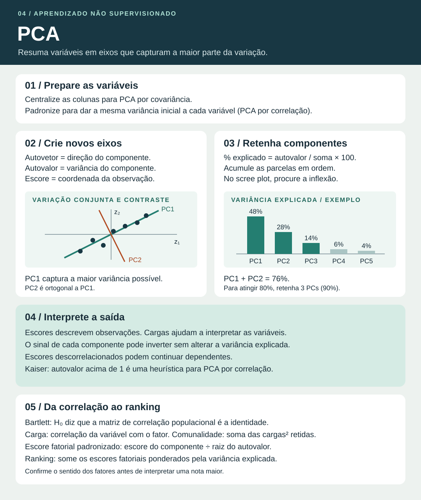

# PCA · análise de componentes principais

A análise de componentes principais transforma variáveis numéricas em **componentes**, combinações lineares das variáveis originais. A primeira direção captura a maior variância possível nos dados. Cada direção seguinte captura a maior variância que resta sob a restrição de ser ortogonal às anteriores. Guardar os primeiros componentes permite representar os dados em menos dimensões.

Imagine duas medidas de volume de entregas que sobem juntas. Um eixo pode capturar o volume geral. Outro pode capturar a diferença entre as duas medidas. Se quase toda a variação estiver no primeiro eixo, ele resume bem o conjunto sob o critério de variância.

## 1. Da base de dados aos componentes

1. Organize $X$ com $n$ observações nas linhas e $p$ variáveis nas colunas.
2. **Centralize** cada coluna subtraindo sua média. Para dar peso comparável a variáveis em unidades diferentes, **padronize** dividindo também pelo desvio padrão da coluna. Trate valores ausentes e avalie o impacto de observações extremas antes do cálculo.
3. Obtenha a matriz de covariância $S=X_c^{\mathsf T}X_c/(n-1)$, em que $X_c$ são os dados centralizados. Com dados padronizados pelo desvio padrão amostral, a matriz de covariância dos escores z é a matriz de correlação das variáveis originais.
4. Encontre autovalores $\lambda_j$ e autovetores unitários $v_j$ que satisfazem $Sv_j=\lambda_j v_j$. Ordene os pares do maior para o menor autovalor.
5. Projete os dados. A coluna $t_j=X_c v_j$ contém os **escores** de todas as observações no componente $j$. Para PCA por correlação, projete os dados padronizados.

A decomposição em valores singulares dos dados centralizados também fornece as direções principais. Se $d_j$ é o valor singular do componente, $\lambda_j=d_j^2/(n-1)$.

| Termo | Significado |
| --- | --- |
| Autovetor $v_j$ | Direção do componente. Seus elementos são os pesos usados para calcular os escores. |
| Autovalor $\lambda_j$ | Variância amostral dos escores do componente $j$. |
| Escore $t_{ij}$ | Coordenada da observação $i$ no componente $j$. |
| Carga (*loading*) | A convenção depende da saída. Pode significar o peso $v_{kj}$ ou a correlação da variável $k$ com o componente $j$. Com dados padronizados e $\lambda_j>0$, essa correlação é $v_{kj}\sqrt{\lambda_j}$. |

## 2. Variância explicada e retenção

$$
\text{Proporção do componente }j=\frac{\lambda_j}{\sum_{k=1}^{p}\lambda_k}
\qquad
\text{Proporção acumulada até }m=\frac{\sum_{j=1}^{m}\lambda_j}{\sum_{k=1}^{p}\lambda_k}
$$

- A soma dos autovalores é a variância total. Para $p$ variáveis padronizadas pelo desvio padrão amostral, essa soma é $p$.
- No **scree plot**, o eixo horizontal lista componentes por ordem e o vertical exibe autovalores ou proporções de variância. O cotovelo é onde a redução se torna menor.
- Em um critério de **variância acumulada**, retenha o menor número de componentes que atinge o alvo definido na questão ou no problema.
- O **critério de Kaiser** retém componentes com autovalor maior que 1 na PCA pela matriz de correlação. É uma heurística. Outras regras podem sugerir outro número.
- Dois componentes podem ser úteis para visualizar os dados. A adequação da figura depende de quanta variância eles retêm e de qual estrutura se quer investigar.

### Exemplo 1 · calcular a variância explicada

Considere cinco variáveis padronizadas com autovalores 2,4, 1,4, 0,7, 0,3 e 0,2. O total é 5. PC1 explica 48%, PC2 explica 28% e PC3 explica 14%. A retenção de dois componentes explica 76%. Para atingir um alvo de 80%, precisamos de três componentes, chegando a 90%. Pelo critério de Kaiser, ficariam dois.

### Exemplo 2 · interpretar pesos e calcular um escore

Duas medidas padronizadas de volume têm correlação 0,8. A matriz de correlação tem diagonal 1 e termos fora da diagonal iguais a 0,8. Seus autovalores são 1,8 e 0,2. As direções unitárias possíveis são $(1,1)/\sqrt{2}$ e $(1,-1)/\sqrt{2}$.

- $\mathrm{PC1}=(z_1+z_2)/\sqrt{2}$ explica 90% da variância e representa a variação conjunta.
- $\mathrm{PC2}=(z_1-z_2)/\sqrt{2}$ explica 10% e representa o contraste entre as medidas.
- Uma rota com $(z_1,z_2)=(2,0)$ tem escore $\sqrt{2}$ em cada componente com os sinais escolhidos acima.

## 3. Como ler os gráficos

- **Gráfico de escores**. Cada ponto é uma observação. As coordenadas mostram seu perfil ao longo dos componentes exibidos. Dois pontos próximos na figura podem se separar em dimensões omitidas.
- **Gráfico de cargas**. Mostra a relação entre variáveis e componentes conforme a escala adotada. Pesos altos em módulo ajudam a identificar as variáveis que caracterizam um eixo.
- **Biplot**. Exibe observações e variáveis no mesmo plano. Em um biplot que usa as correlações como coordenadas das setas, setas bem representadas e quase paralelas sugerem correlação positiva. Setas opostas sugerem correlação negativa e setas quase perpendiculares sugerem associação linear pequena. Verifique a escala e a representação no plano antes de interpretar.
- **Sinal**. Um autovetor pode ser multiplicado por −1. Isso espelha os escores naquele eixo e preserva a variância explicada e as relações entre observações. Interprete pesos e escores usando os sinais da mesma solução.

## 4. Análise fatorial por componentes principais no material do curso

### Correlação de Pearson e teste de Bartlett

Na abordagem da aula, o ponto de partida é a matriz $R$ de correlações de Pearson entre as variáveis métricas. Para duas variáveis, $r_{xy}=\operatorname{cov}(X,Y)/(s_Xs_Y)$. A diagonal de $R$ vale 1. Correlações fortes em módulo sinalizam variação linear compartilhada e potencial de redução de dimensão. Se $R$ se aproxima da identidade, a variância tende a se distribuir entre os componentes.

O **teste de esfericidade de Bartlett** avalia a hipótese nula de que a matriz de correlação populacional é a identidade. Com $n$ observações, $p$ variáveis e matriz amostral $R$ não singular, a estatística aproximada é:

$$
\chi^2=-\left[n-1-\frac{2p+5}{6}\right]\ln(\det R),
\qquad gl=\frac{p(p-1)}{2}.
$$

Um valor-p abaixo de $\alpha$ dá evidência de correlação linear entre pelo menos um par. Escolha quantos componentes reter usando autovalores, variância explicada e objetivo da análise. Por exemplo, com $n=40$ e duas variáveis com $r=0{,}8$, $\det R=1-0{,}8^2=0{,}36$. A estatística é aproximadamente 38,31 com 1 grau de liberdade, acima do valor crítico de 3,84 a 5%. [Documentação do teste de Bartlett](https://search.r-project.org/CRAN/refmans/EFAtools/help/BARTLETT.html)

### Pesos fatoriais, cargas e comunalidade

- A equação característica $\det(R-\lambda I)=0$ fornece os autovalores. Para cada um, resolva $(R-\lambda_j I)v_j=0$ e normalize o autovetor.
- A aula usa **escores fatoriais padronizados** $F_{ij}=t_{ij}/\sqrt{\lambda_j}$, para autovalor positivo. Aplique aos escores z da observação os pesos $v_{kj}/\sqrt{\lambda_j}$. A variância dos escores $t_j$ antes dessa divisão é $\lambda_j$. Depois, a variância amostral dos escores $F_j$ vale 1.
- A **carga fatorial** $\ell_{kj}=v_{kj}\sqrt{\lambda_j}$ é a correlação da variável padronizada $k$ com o fator $j$. Examine seu módulo para medir a força e seu sinal para interpretar o sentido.
- A **comunalidade** $h_k^2=\sum_{j\in J}\ell_{kj}^2$ soma as cargas ao quadrado da variável $k$ nos fatores retidos $J$. Uma comunalidade de 0,90 indica que esses fatores representam 90% da variância daquela variável padronizada.

No exemplo de duas variáveis com $r=0{,}8$, Kaiser retém PC1. A carga de cada variável em PC1 vale $\sqrt{1{,}8}/\sqrt{2}=\sqrt{0{,}9}\approx0{,}949$. Sua comunalidade é 0,90. Para a rota do exemplo, o escore padronizado é $\sqrt{2}/\sqrt{1{,}8}\approx1{,}054$.

### Ranking por soma ponderada

Multiplique o escore de cada fator retido por sua proporção da variância original e some. Se $q_j=\lambda_j/\sum_k\lambda_k$, o índice da observação $i$ fica $R_i=\sum_{j\in J}q_jF_{ij}$. No exemplo, com apenas PC1 retido, o índice da rota é $0{,}90\times1{,}054\approx0{,}949$. Alinhe a orientação dos fatores com o significado de uma nota maior antes de ordenar o ranking. O sinal de cada autovetor pode inverter.

## 5. Diferenças e limites que valem revisar

| Ideia | Como interpretar |
| --- | --- |
| Covariância ou correlação? | Covariância preserva a escala original. Correlação equivale a padronizar e dá variância inicial igual a cada variável. |
| Direções ortogonais e escores descorrelacionados | As direções formam ângulos retos. Na amostra usada no ajuste, a covariância entre escores de componentes diferentes é zero. Independência estatística exige condições adicionais. |
| Redução ou seleção de variáveis? | PCA cria variáveis novas, que podem combinar todas as originais. Seleção mantém um subconjunto das colunas originais. |
| PCA ou clustering? | PCA cria eixos e coordenadas para descrever a variação. Clustering atribui observações a grupos. PCA pode preceder clustering, mas dimensões descartadas podem conter informação relevante para separar grupos. |
| PCA ou análise fatorial? | PCA resume a variância total observada. A análise fatorial modela a covariação por fatores comuns e prevê variância específica ou erro. |
| Variância alta significa maior poder preditivo? | PCA ordena componentes pela variância dos preditores. Um componente de baixa variância pode ser importante para prever um desfecho. |
| Usar PCA em um modelo preditivo | Ajuste centragem, escala e componentes nos dados de treino. Aplique a mesma transformação aos dados de validação e teste. |

Ao reter $m$ componentes, a reconstrução centralizada é $\widehat X_c=T_m V_m^{\mathsf T}$, onde $V_m$ reúne os autovetores retidos. Para voltar às unidades originais, desfaça a padronização ou some as médias quando houver apenas centragem. Os componentes descartados respondem pela variância perdida.

Material consultado da USP/Esalq. *Unsupervised Machine Learning: Análise Fatorial e PCA*, aulas de 25/11 e 02/12/2025.

Fonte complementar para centragem, projeção e variância. [Guia de PCA do scikit-learn](https://scikit-learn.org/stable/modules/decomposition.html#principal-component-analysis-pca)
