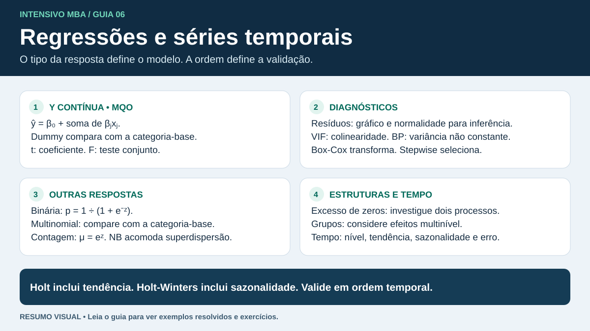

# Econometria e séries temporais

## Estimação em econometria

| Método | O que otimiza | Exemplo de aplicação |
|---|---|---|
| Mínimos quadrados ordinários (MQO ou OLS) | Minimiza a soma dos quadrados dos resíduos, $\sum_i(y_i-\hat y_i)^2$. | Regressão linear para estimar custo em função da distância. |
| Máxima verossimilhança (MV ou MLE) | Escolhe parâmetros que maximizam a verossimilhança dos dados observados sob o modelo. Costuma-se maximizar a log-verossimilhança, que preserva o máximo. | Regressão logística com resposta binária ou Poisson com resposta de contagem. |

Com erros normais independentes e variância constante, maximizar a verossimilhança da regressão linear produz os mesmos coeficientes de MQO. Os critérios também podem diferir conforme o modelo probabilístico e o tipo de desfecho.

**Exemplo de MQO.** Para observações $(1,2)$, $(2,4)$ e $(3,5)$, a reta $\hat y=0{,}5+1{,}5x$ produz resíduos $0$, $0{,}5$ e $0$. A soma de quadrados é $0{,}25$. A reta $\hat y=2x$ produz resíduos $0$, $0$ e $-1$, com soma de quadrados $1$. O critério prefere a primeira entre essas duas candidatas. Com intercepto, a reta de MQO também passa pelo ponto $(\bar x,\bar y)$ e, neste exemplo, é $\hat y=2/3+1{,}5x$.

**Exemplo de máxima verossimilhança.** Para quatro entregas independentes com a mesma probabilidade $p$ de atraso, suponha que três atrasaram. A verossimilhança da sequência observada é $p^3(1-p)$. Ela vale $0{,}0625$ em $p=0{,}5$ e cerca de $0{,}1055$ em $p=0{,}75$, que é o máximo. Se $p$ depender de características como distância e janela de entrega, a logística permite modelar essa dependência.

Em questões de interpretação, confira se o enunciado pede estimativa, previsão ou efeito causal. O coeficiente da regressão descreve uma associação ajustada às variáveis incluídas. Uma interpretação causal exige um desenho ou hipóteses adicionais, como o tratamento adequado de fatores de confusão.

## Regressão linear simples e múltipla

Na simples, uma variável explica a média condicional de um alvo quantitativo. Na múltipla, o coeficiente de cada preditor é a diferença esperada para uma unidade a mais nesse preditor, mantendo fixos os demais. O intercepto é a previsão quando os preditores valem zero. Sua utilidade depende de zero fazer sentido e de estar no domínio dos dados.

**Previsão com dummy.** Em $\hat y=30+0{,}8d+12N$, $d$ é distância em km e $N=1$ indica turno noturno. Para 50 km à noite, a previsão é $30+40+12=82$. O turno diurno é a referência. Para um fator de $k$ categorias, use $k-1$ dummies quando houver intercepto. Se houver interação $dN$, a diferença entre turnos passa a depender da distância.

| Item do output | Leitura correta |
|---|---|
| Coeficiente, erro padrão e teste t | O teste t usual avalia $H_0:\beta_j=0$ para um coeficiente individual. O intervalo expressa a incerteza da estimativa. |
| Teste F global | Com intercepto, testa a hipótese de que todas as inclinações são zero. Rejeitar indica evidência contra a hipótese conjunta. |
| R² | Fração da variação da resposta explicada em treino, no MQO usual com intercepto. Aumenta ou permanece igual ao adicionar variáveis no mesmo conjunto de dados. |
| R² ajustado | Penaliza o número de preditores e pode cair com uma variável adicional. Para desempenho preditivo, verifique erro fora da amostra. |
| VIF e tolerância | $VIF_j=1/(1-R_j^2)$ e tolerância $=1/VIF_j$. O $R_j^2$ vem de prever o regressor $j$ com os demais. VIF elevado aponta dificuldade em isolar coeficientes. |
| Breusch-Pagan | $H_0$ é variância constante. Um p-valor baixo sugere heterocedasticidade. Erros padrão robustos podem corrigir a inferência sem alterar os coeficientes de MQO. |
| Gráfico Q–Q e teste de normalidade | Avaliam a distribuição dos resíduos. Normalidade é relevante para a inferência exata clássica em amostras pequenas. P-valor alto indica evidência insuficiente para rejeitar, dentro do teste. |
| Resíduos versus ajustados | Curvatura sugere especificação incompleta. Um formato de funil sugere variância que muda ao longo das previsões. |

**Exemplo de leitura.** Um modelo apresenta p-valor global do F de 0,001, p-valor de 0,04 para distância e 0,28 para turno. A 5%, há evidência conjunta contra inclinações todas nulas e evidência individual para distância. Para turno, a evidência individual é insuficiente. Com Breusch-Pagan em 0,02, vale verificar a inferência com erros padrão robustos. VIF 5 corresponde a tolerância 0,20.

### Não linearidade, Box-Cox e Stepwise

Um termo quadrático em $x$ pode representar curvatura mesmo quando o modelo é linear nos coeficientes. Um modelo exponencial, como $y=ae^{bx}$, produz variação multiplicativa. No modelo $\ln(y)=a+bx$, um aumento unitário de $x$ multiplica o valor ajustado de volta à escala original por $e^b$. Retransformar o valor esperado na escala log por exponenciação direta pode subestimar a média na escala original.

A transformação Box-Cox clássica se aplica a uma resposta positiva. Para $\lambda\ne 0$, use $(y^\lambda-1)/\lambda$. Para $\lambda=0$, use $\ln(y)$. Ela pode ajudar a estabilizar a variância e melhorar o ajuste. Reavalie os resíduos após transformar. Se o valor previsto na escala transformada for 2 e $\lambda=0$, a retrotransformação pontual é $e^2\approx7{,}39$.

**Stepwise** adiciona e remove variáveis por um critério, como AIC ou testes predefinidos. Forward começa com um modelo menor e adiciona termos. Backward começa com um modelo maior e remove termos. Preserve a hierarquia ao incluir interações e faça a seleção dentro do treino. A seleção automática pode ser instável e seus p-valores precisam ser lidos considerando a busca feita.

## Modelos logísticos binários e multinomiais

Para um evento binário, a logística usa $\eta=\beta_0+\sum_j\beta_jx_j$. O **logito** é $\ln(p/(1-p))=\eta$, as **chances** são $p/(1-p)=e^\eta$ e a **probabilidade** é $p=1/(1+e^{-\eta})$.

**Exemplo.** Se $\eta=-2+0{,}7x$, então $x=2$ dá $\eta=-0{,}6$ e $p\approx0{,}354$. Uma unidade a mais de $x$ multiplica as chances por $e^{0{,}7}\approx2{,}01$. A mudança de probabilidade depende do ponto de partida. Um limiar de 0,5 gera classe negativa nesse exemplo. Um limiar de 0,3 gera classe positiva. Compare as métricas para escolher o limiar de acordo com o custo dos erros.

- **Binária** usa duas categorias. Na avaliação, leia a matriz de confusão, a especificidade e a sensibilidade. A curva ROC varia o limiar e compara sensibilidade com a taxa de falsos positivos.
- **Multinomial** cobre três ou mais categorias sem ordem natural. Cada categoria tem uma equação contra a referência, com $\eta_\text{ref}=0$. Divida $e^{\eta_j}$ pela soma dos exponenciais de todas as categorias. Se as pontuações são $0$, $\ln(2)$ e $\ln(3)$, as probabilidades são $1/6$, $2/6$ e $3/6$. A razão de chances de uma categoria é interpretada em relação à referência.
- Testes de Wald avaliam coeficientes individualmente. O teste de razão de verossimilhanças compara modelos aninhados. Em um output, $\exp(\beta)$ é a razão de chances multiplicativa, enquanto $\beta$ está na escala do logito.

## Modelos para dados de contagem

Para uma resposta inteira não negativa, modele $\log(E[Y\mid X])=\eta$. A previsão da média é $e^\eta$. Ela pode ser fracionária. O modelo opera sobre o log da média, o que permite incluir observações iguais a zero. A razão de taxas associada a um aumento de uma unidade no preditor é $e^{\beta_j}$, mantendo os demais fixos.

| Modelo | Sinal de uso |
|---|---|
| Poisson | Média e variância condicionais iguais sob a especificação usual. |
| Binomial negativa | Pode acomodar variância condicional maior que a média. Investigue superdispersão após considerar os preditores. |
| Poisson ou binomial negativa inflacionados de zeros | Uma parte do processo gera zeros estruturais. A outra parte gera contagens e também pode gerar zero. |
| Hurdle | Uma parte modela zero versus positivo. A parte de contagem modela apenas valores positivos. |

**Exemplo de exposição.** Se uma empresa acompanha rotas por durações diferentes, inclua $\ln(\text{dias observados})$ como **offset**, com coeficiente fixo 1. Uma taxa prevista de 0,2 ocorrências por dia em 15 dias corresponde a média de 3 ocorrências. Se um preditor tiver coeficiente $\ln(1{,}5)$, a taxa multiplica por 1,5 a cada unidade.

**Exemplo de excesso de zeros.** Em um modelo inflacionado de zeros, a probabilidade estrutural de zero é 0,25 e a média do componente de Poisson é 2. A média total é $(1-0{,}25)\cdot2=1{,}5$. A probabilidade total de zero é $0{,}25+0{,}75e^{-2}\approx0{,}352$. O excesso de zeros sozinho pede comparação com outras especificações e uma explicação plausível para os dois processos.

## Modelagem multinível

Use quando registros pertencem a grupos, como entregas dentro de filiais. Registros da mesma filial podem ser parecidos. Um intercepto aleatório permite que cada grupo se desloque da média geral. Uma inclinação aleatória permite também que o efeito de um preditor varie por grupo.

- **Efeito fixo** no modelo misto é o coeficiente populacional, como uma variação média por km.
- **Efeito aleatório** é uma variação do intercepto ou da inclinação de um grupo em torno da média populacional. Os grupos compartilham informação por meio da distribuição dos efeitos.
- **ICC**, no modelo linear com intercepto aleatório, é a fração da variância total atribuída ao grupo, $\tau^2/(\tau^2+\sigma^2)$. Com variância entre filiais 4 e residual 12, ICC = 0,25. A interpretação depende da escala e da estrutura do modelo.
- **Exemplo de previsão.** Se $\hat y_{ij}=20+0{,}5x_{ij}+u_j$, a filial com $u_j=4$ tem previsão 29 em $x=10$. Com efeito de filial desconhecido, a previsão populacional é 25 sob o modelo de média zero para $u_j$.
- **Leia o output.** Separe a tabela dos coeficientes fixos da tabela de variâncias. Um valor de variância de grupo mostra dispersão entre grupos, enquanto o coeficiente fixo mostra direção e magnitude média. Em Python, MixedLM estima modelos lineares mistos.

## Séries temporais

Uma série temporal é uma sequência indexada no tempo. A ordem das observações permite investigar dependência, tendência e padrões sazonais. Registre a frequência dos dados antes de escolher o modelo. Em uma série mensal com padrão anual, a periodicidade sazonal é 12.

| Componente | Como reconhecer |
|---|---|
| Nível | Patamar em torno do qual a série oscila. |
| Tendência | Crescimento ou queda persistente no nível. |
| Sazonalidade | Padrão que se repete em intervalos fixos, como o aumento de entregas em dezembro. |
| Ciclo | Alternância de expansão e retração com duração variável. |
| Resíduo | Variação que sobra após estimar os componentes. |

Na decomposição aditiva, $y_t=T_t+S_t+R_t$. Ela faz sentido quando a oscilação sazonal tem tamanho semelhante ao longo da série. Na multiplicativa, $y_t=T_t S_t R_t$, a oscilação cresce ou encolhe aproximadamente em proporção ao nível. Por exemplo, um dezembro com 200 entregas adicionais a cada ano sugere efeito aditivo. Um dezembro com 20% a mais sugere efeito multiplicativo.

## Médias móveis e referências de comparação

- **Média móvel centrada de três períodos** no instante $t$ usa $t-1$, $t$ e $t+1$. Ela suaviza o histórico para estimar o nível local.
- **Previsão pela média móvel de três períodos** para $t+1$ usa os três valores mais recentes conhecidos, $t-2$, $t-1$ e $t$.
- **Previsão ingênua** repete o último valor observado. A **ingênua sazonal** usa o último valor observado da mesma posição no ciclo, como o dezembro anterior.

**Exemplo.** De janeiro a abril, foram registrados 14, 22, 24 e 32 pedidos. A média centrada de fevereiro é $(14+22+24)/3=20$. A previsão para maio pela média móvel é $(22+24+32)/3=26$.

## Suavização exponencial

| Método | Componentes que atualiza | Situação típica |
|---|---|---|
| Suavização exponencial simples | Nível | Série com flutuações em torno de um nível, sem tendência nem sazonalidade sistemática. |
| Holt | Nível e tendência | Série com crescimento ou queda persistente. |
| Holt-Winters | Nível, tendência e sazonalidade | Série com tendência e padrão periódico. |

Na suavização simples, $ell_t=alpha y_t+(1-alpha)ell_{t-1}$ e a previsão futura é o último nível estimado. Quanto maior $alpha$, mais o nível reage à última observação. Com nível anterior 100, observação 120 e $alpha=0{,}3$, o nível atualizado é 106. Em Holt, a projeção com tendência linear para $h$ passos é $ell_t+h b_t$. Um nível de 106 e tendência de 4 por período dão previsão 118 a três passos. Em Holt-Winters, o ajuste sazonal soma ou multiplica a previsão conforme a estrutura escolhida.

## Avaliação da previsão

Defina $e_t=y_t-hat y_t$. Faça a avaliação em períodos posteriores ao treino. Na validação com origem móvel, avance a data de corte e reavalie o modelo em horizontes do mesmo tamanho.

| Métrica | Como calcular | Como interpretar |
|---|---|---|
| MAE | Média de $lvert e_t
vert$ | Erro absoluto típico na unidade original. |
| RMSE | Raiz da média de $e_t^2$ | Erro na unidade original, com mais peso para erros grandes. |
| MAPE | Média de $lvert e_t/y_t
vert$ vezes 100 | Erro percentual médio em magnitude. Fica indefinido com valores reais iguais a zero e instável perto de zero. |
| Erro médio | Média de $e_t$ | Com a definição acima, valor positivo indica que as previsões ficaram abaixo dos valores reais em média. |

**Exemplo.** Vendas reais de 100 e 200, previsões de 110 e 180. Os erros são −10 e 20. MAE = 15, RMSE = $sqrt{250}approx15{,}81$ e MAPE = $(10%+10%)/2=10%$.

## Interpretação de prova

- Sublinhe a data de referência. Se pedirem a previsão de junho, verifique quais observações estavam disponíveis antes de junho.
- Compare modelos na mesma série, no mesmo horizonte e nos mesmos períodos de teste. Observe a unidade da métrica antes de interpretar a diferença.
- Um pico repetido em todo dezembro sugere sazonalidade. Picos em datas irregulares podem refletir eventos ou ciclos.
- Em uma regressão com dados no tempo, autocorrelação nos resíduos pode sinalizar estrutura temporal ainda disponível. Duas séries que crescem juntas podem ter regressão aparentemente forte por causa da tendência comum. Em séries, uma boa avaliação depende de previsões fora da amostra com a ordem temporal preservada.

## Checagem rápida

1. Pedidos mensais sobem gradualmente e o pico de dezembro é de cerca de 15% acima do patamar. Qual método e tipo de sazonalidade fazem sentido?
2. Um modelo prevê 50 unidades quando o real foi 40. Qual é o erro com sinal? Qual é o erro absoluto percentual?
3. A sequência conhecida é 20, 23, 29, 32. Qual é a próxima previsão pela média móvel de três períodos?
4. Uma regressão tem teste F global com p = 0,002, um coeficiente individual com p = 0,31 e VIF = 8 para essa variável. O que cada número sinaliza?
5. Em logística binária, qual a probabilidade prevista se o logito é zero? Em Poisson com ligação log, qual a média se o preditor linear é zero?
6. Em um modelo linear multinível, a variância entre filiais é 9 e a variância residual é 27. Quanto vale o ICC?

Ver respostas

1. Holt-Winters multiplicativo, pois há tendência e amplitude sazonal proporcional ao nível.
2. Erro de −10 unidades e erro absoluto percentual de 25%.
3. $(23+29+32)/3=28$.
4. Há evidência contra a hipótese global a 5%, evidência individual insuficiente para esse coeficiente e forte associação linear entre o regressor em questão e os demais, o que pode inflar a incerteza.
5. Logística: $1/(1+e^0)=0{,}5$. Poisson: $e^0=1$.
6. $9/(9+27)=0{,}25$, ou 25%.

**Material consultado no portal USP/Esalq**

- *Modelos Logísticos Binários e Multinomiais* (10 e 17/03/2026, slides p. 3 e 11–18).
- *Modelos para Dados de Contagem* (24 e 31/03/2026, slides p. 3 e 8–19).
- *Modelagem Multinível* (07 e 14/04/2026, slides p. 3–4, 17–18 e 30–42).
- *Aula Extra: Exercícios de Séries Temporais* (14/08/2026, slides p. 4–19).

[Penn State · MQO](https://online.stat.psu.edu/stat501/Lesson01) · [Máxima verossimilhança na logística](https://online.stat.psu.edu/stat501/Lesson13) · [Forecasting: Principles and Practice · suavização exponencial](https://otexts.com/fpp3/exponential-smoothing.html) · [Avaliação da precisão](https://otexts.com/fpp3/toolbox.html#evaluating-point-forecast-accuracy)
