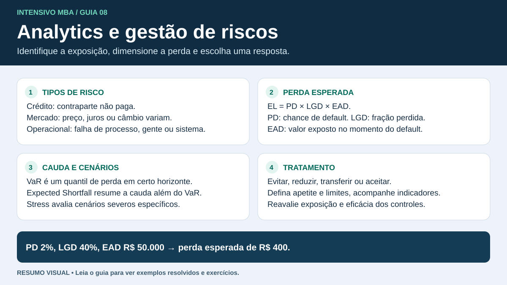

# Analytics e gestão de riscos

## Categorias e controles

| Risco | De onde vem | Exemplo |
|---|---|---|
| Crédito | A contraparte pode descumprir suas obrigações. | Cliente atrasa ou deixa de pagar parcelas. |
| Mercado | Mudanças de preços, juros, câmbio ou outras variáveis de mercado afetam a posição. | A alta do dólar encarece uma dívida em moeda estrangeira. |
| Liquidez | Dificuldade de cumprir pagamentos quando vencem ou de vender posições sem desconto relevante. | Falta caixa imediato apesar de haver ativos a receber. |
| Operacional | Falha de processos, pessoas, sistemas ou eventos externos. | Um erro de integração gera cobranças duplicadas. |
| Legal | Perda ligada a obrigações contratuais, normas ou litígios. | Multa decorrente de um processo mal executado. |
| Compliance | Exposição ligada ao descumprimento de normas, regras internas ou padrões de conduta. | Ausência de uma verificação obrigatória no cadastro. |
| Social e ambiental | Exposição a impactos e eventos de natureza social ou ambiental. | Um impacto ambiental interrompe operações ou gera responsabilidade. |

O arcabouço de Basileia inclui risco legal na definição regulatória de risco operacional. Em um enunciado que oferece os dois como categorias, observe se a pergunta pede a causa mais específica ou o enquadramento regulatório. [BIS · introdução ao risco operacional](https://www.bis.org/committees/bcbs/basel-consolidated-guidelines/module/orr/10)

O processo de gestão começa por identificar o evento e seu impacto, depois estimar frequência e severidade, escolher um tratamento e monitorar o risco residual. É possível evitar a atividade, reduzir a probabilidade ou o impacto, transferir parte do impacto ou aceitar a exposição dentro dos limites definidos. Um seguro transfere perdas cobertas e deixa exposições como a franquia. Conciliação automatizada e revisão de exceções podem reduzir o risco operacional.

## Risco de crédito

| Componente | Significado | Unidade típica |
|---|---|---|
| PD | Probabilidade de inadimplência no horizonte considerado. | Percentual ou fração. |
| LGD | Fração da exposição que se perde caso haja inadimplência. | Percentual ou fração. |
| EAD | Exposição estimada no momento da inadimplência. | Moeda. |
| EL | Perda esperada. Em um modelo simples de um período, o valor em moeda é $PD	imes LGD	imes EAD$. | Moeda. |

**Exemplo.** Uma carteira representada por uma exposição de R\$ 100.000 tem PD de 3% e LGD de 40%. A perda condicionada ao default é R\$ 40.000 e a perda esperada no período é $0{,}03	imes0{,}40	imes100.000=$ R\$ 1.200. A taxa de perda esperada sobre a EAD é 1,2%. Se a LGD cair para 25% com a mesma PD e EAD, a perda esperada cai para R\$ 750. A perda de uma operação individual pode exceder a média. No contexto de Basileia, distinga a perda esperada da perda inesperada e do capital voltado a absorver exposições a perdas inesperadas. [BIS · perdas esperadas no método IRB](https://www.bis.org/committees/bcbs/basel-framework/standard/cre/35/inforce/2019-12-15/published/2019-12-15) · [BIS · funções de ponderação de risco](https://www.bis.org/committees/bcbs/basel-framework/standard/cre/31/inforce/2019-12-15/published/2019-12-15)

## Cenários, decisão e interpretação

**Exemplo.** Um novo processo tem perda estimada de R\$ 2.000 no cenário normal (85%), R\$ 10.000 no adverso (10%) e R\$ 50.000 no severo (5%). A perda esperada é $0{,}85	imes2.000+0{,}10	imes10.000+0{,}05	imes50.000=$ R\$ 5.200. Um controle custa R\$ 1.000 e reduz a perda severa para R\$ 20.000, mantendo as probabilidades e demais perdas. A perda esperada passa a R\$ 3.700, ou R\$ 4.700 com o custo do controle. Nas premissas do exemplo, a economia esperada líquida é R\$ 500.

- Uma análise de sensibilidade varia um ou mais parâmetros para observar o efeito no resultado. Um teste de estresse avalia o impacto de um cenário severo e plausível.
- Em crédito, a logística pode estimar PD para um horizonte e uma definição de inadimplência. Um escore pode ordenar casos por risco, mas sua conversão em probabilidade exige calibração. Valide em dados posteriores e observe mudanças no perfil dos clientes.
- Em questões de cálculo, confira se o enunciado pede probabilidade, perda em caso de default, taxa esperada ou perda esperada em moeda. A unidade costuma separar alternativas parecidas.
- Em estudos de caso, identifique a exposição e a consequência, depois relacione o controle ao componente que ele altera. Uma garantia pode alterar a severidade conforme as condições de recuperação.

## Basileia e perdas extremas

Nos slides, Basileia I aparece associada ao requisito de capital para risco de crédito e Basileia II à ampliação do tratamento, incluindo risco operacional. Basileia III reforçou a qualidade e a quantidade de capital e introduziu padrões de liquidez e de alavancagem. Para a prova, associe a evolução à ampliação da cobertura e à resiliência diante de choques. [BIS · visão geral de Basileia III](https://www.bis.org/bcbs/basel3.htm)

- Uma distribuição de perdas pode ter muitos eventos pequenos e poucos eventos muito severos. A média descreve a perda esperada. Um quantil alto descreve um limiar de cauda para um horizonte definido.
- Em uma questão que calcula **excesso de perda sobre o valor esperado**, use a diferença entre a perda de cauda fornecida e a perda média. Se o limiar de perda é R\$ 50.000 e a perda esperada é R\$ 5.200, o excesso é R\$ 44.800. A convenção usual de VaR usa o próprio quantil da distribuição de perdas como limiar. Leia a definição do exercício antes de operar.
- Uma instituição pode registrar frequência, severidade e perdas operacionais. Uma interrupção rara com impacto muito alto merece análise separada, mesmo quando a média do histórico é baixa.

## Checagem rápida

1. PD de 4%, EAD de R\$ 200.000, LGD de 30%. Calcule a perda condicional ao default e a perda esperada.
2. O software de cobrança fica fora do ar por dois dias. Qual risco explica diretamente o incidente? Se a empresa perde uma disputa contratual por causa do ocorrido, que categoria descreve essa consequência?
3. Compare A (PD 4%, LGD 20%, EAD R\$ 100.000) e B (PD 2%, LGD 70%, EAD R\$ 100.000). Qual tem maior perda esperada?

Ver respostas

1. Perda condicional de R\$ 60.000 e perda esperada de R\$ 2.400.
2. O incidente é operacional. A disputa contratual gera risco legal.
3. A tem R\$ 800 e B tem R\$ 1.400. B tem maior perda esperada.

**Material consultado no portal USP/Esalq** · *Analytics e Gestão de Riscos I e II* (aula II de 07/10/2025, slides p. 3, 26–35 e 45–46).
