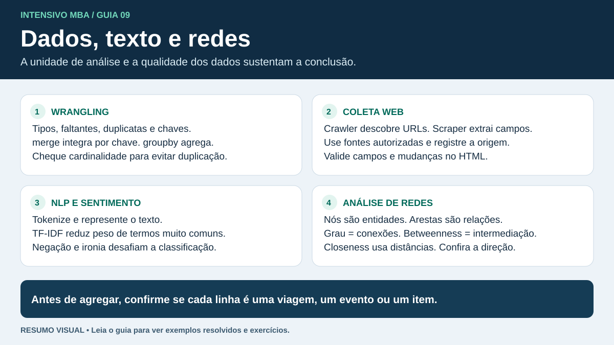

# Tratamento de dados, coleta na web, texto e redes



**Para a prova.** Reconheça o que uma função recebe e devolve, acompanhe a unidade de cada linha após uma transformação e escolha a métrica de rede conforme a pergunta. Os exemplos abaixo usam dados sintéticos.

## 1. Data Wrangling com pandas

Wrangling é transformar dados brutos em dados adequados para uma análise. Uma tabela arrumada (*tidy*) representa cada variável em uma coluna, cada observação em uma linha e cada tipo de unidade observacional em uma tabela. O grão, como “uma linha por viagem”, determina quais repetições são legítimas.

| Tarefa | Comando | Como ler o resultado |
|---|---|---|
| Ver linhas iniciais | `df.head()` | Amostra visual do começo, útil para inspecionar colunas |
| Ver tipos e não nulos | `df.info()` | Resumo de esquema e completude. O método imprime e devolve `None`. |
| Medir faltantes por coluna | `df.isna().sum()` | Contagem de ausências por variável |
| Selecionar por posição | `df.iloc[40, :]` | 41ª linha e todas as colunas, se existirem 41 linhas |
| Selecionar por rótulo | `df.loc[40, "rota"]` | Coluna `rota` das linhas com rótulo 40, quando existir |
| Ordenar do maior para o menor | `df.sort_values("peso", ascending=False)` | Reordena pelas observações de maior peso |
| Converter tipo conhecido | `df.astype({"id": "string"})` | Ajusta o tipo de coluna. Preserve identificadores com zeros à esquerda desde a importação. |
| Converter texto numérico | `pd.to_numeric(df["peso"], errors="coerce")` | Conversões inválidas viram ausências e podem ser auditadas |
| Renomear | `df.rename(columns={"Peso Kg": "peso_kg"})` | Muda o rótulo sem mudar os valores |
| Empilhar tabelas compatíveis | `pd.concat([jan, fev], ignore_index=True)` | Adiciona linhas, alinhando colunas por rótulo |
| Combinar por chave | `viagens.merge(rotas, on="id_rota", how="left", validate="many_to_one")` | Mantém viagens e verifica se cada rota da tabela de referência tem chave única |
| Calcular medida por grupo | `df.groupby("filial")["peso"].mean()` | Uma média de peso por filial |
| Faixas com limites definidos | `pd.cut(df["peso"], bins=[0, 10, 20, 30])` | Classes pelos limites escolhidos. Por padrão, os intervalos incluem a extremidade direita. |
| Faixas por quantis | `pd.qcut(df["peso"], q=4)` | Busca grupos de frequência parecida, com larguras variáveis. Empates podem repetir limites. |

**Sequência de trabalho.** Defina o grão e inspecione tipos. Padronize unidades, datas e categorias. Investigue faltantes e duplicados. Combine e reorganize tabelas. Valide contagens, chaves e limites depois da transformação. [Guia do pandas](https://pandas.pydata.org/docs/user_guide/10min.html)

- **Ausência e zero.** Um peso ausente e um peso igual a zero têm significados diferentes. Entenda a origem do dado antes de usar `dropna` ou `fillna`. Se houver modelagem, estime imputação e normalização só no treino e aplique o mesmo procedimento aos demais conjuntos.
- **Duplicatas e junções.** Duas linhas com a mesma filial podem representar viagens distintas. Uma junção pode multiplicar linhas se a chave se repete nas duas tabelas. Se houver duas viagens e três linhas de cadastro para uma rota, uma junção por essa rota gera seis linhas.
- **Formato largo e longo.** `melt` converte colunas como `jan` e `fev` em linhas com uma coluna `mes`. `pivot` espalha categorias em colunas e exige pares de índice e coluna únicos. `pivot_table` permite definir como agregar repetições.

## 2. Crawlers, scraping e APIs

| Conceito | Papel |
|---|---|
| Crawler | Descobre e percorre páginas seguindo links e regras de navegação |
| Scraper | Extrai campos de documentos e os estrutura |
| API | Fornece acesso por endpoints e parâmetros definidos pelo serviço |
| HTML/DOM | Estrutura de elementos, atributos e texto usada para localizar informações |

Fluxo típico de scraping estático. Faça uma requisição HTTP com limite de tempo. Confira o status e o tipo de conteúdo. Analise o HTML, extraia texto e atributos, limpe os valores e registre a origem. O Beautiful Soup analisa documentos já obtidos. [Documentação do Beautiful Soup](https://www.crummy.com/software/BeautifulSoup/bs4/doc/)

```python
from bs4 import BeautifulSoup

html = '<a class="rota" href="/rotas/7">São <strong>Paulo</strong></a>'
soup = BeautifulSoup(html, "html.parser")
link = soup.select_one("a.rota")

if link is not None:
    nome = link.get_text(" ", strip=True)  # São Paulo
    caminho = link.get("href")             # /rotas/7
```

- `select_one` procura a primeira correspondência e pode retornar `None`. `select` procura todas. `get_text` extrai texto descendente. Para capturar URL, leia o atributo `href` e resolva caminhos relativos contra a URL de origem.
- Um crawler controla paginação, URLs já visitadas e limites de escopo. Um scraper deve lidar com campo faltante, seletor que mudou e página vazia.
- Status 200 indica sucesso da requisição, 404 indica recurso não encontrado e 429 indica excesso de requisições. Trate limites de frequência e regras de acesso do serviço.
- Conteúdo inserido por JavaScript pode aparecer no navegador e estar ausente do HTML inicial. Primeiro identifique se existe uma API autorizada para recuperar os dados.

## 3. Text Mining, NLP e análise de sentimentos

**Text Mining** extrai padrões de coleções de texto. **NLP** reúne técnicas para representar e processar linguagem, como classificação de texto, extração de entidades e sumarização. **Análise de sentimentos** identifica polaridade ou opinião, inclusive por aspecto.

| Etapa | Exemplo e efeito |
|---|---|
| Tokenização | “Entrega no prazo” pode virar `["Entrega", "no", "prazo"]` |
| Lowercasing | “ENTREGA RÁPIDA!” vira “entrega rápida!” |
| Stopwords | Pode reduzir termos frequentes. Preserve “não” quando a tarefa depende de negação. |
| Stemming | Aplica regras de redução que podem produzir formas truncadas |
| Lematização | Mapeia para uma forma de dicionário, como “entregaram” → “entregar”, quando a análise reconhece o verbo |
| Bag of words | Vetor de presença ou contagem por termo. Unigramas perdem ordem. |
| N-gramas | Capturam sequências locais, como o bigrama “não chegou” |
| TF–IDF | Dá peso maior a termos frequentes no documento e relativamente raros na coleção |
| Embeddings | Vetores densos que podem representar semelhança semântica. Alguns variam com o contexto. |

**Leitura de matriz.** Com documentos “carga entregue” e “carga atrasada”, o vocabulário na ordem [carga, entregue, atrasada] produz vetores de contagem [1, 1, 0] e [1, 0, 1]. “Carga” aparece nos dois textos. O IDF reduz a importância relativa de termos comuns. A fórmula exata depende da convenção de suavização e normalização. [Extração de atributos no scikit-learn](https://scikit-learn.org/stable/modules/feature_extraction.html)

**Sentimento.** Decida primeiro a granularidade da saída.

| Nível | Resultado esperado |
|---|---|
| Documento | Um rótulo para a avaliação inteira |
| Frase | Um rótulo para cada frase |
| Aspecto | Um rótulo para cada atributo comentado, mesmo quando os atributos aparecem na mesma frase |

Em “A entrega foi rápida, mas a embalagem chegou rasgada”, o sentimento sobre o prazo é positivo e o da embalagem é negativo. Uma escala pode usar três rótulos (negativo, neutro, positivo) ou distinguir intensidades. Defina também como tratar comentários com opiniões mistas e comentários sem opinião.

**Fluxo de trabalho.** Colete textos, prepare-os, converta-os em representações numéricas, classifique e avalie. Um método léxico combina palavras e regras. Um supervisionado aprende com textos rotulados, com modelos clássicos ou redes profundas. Negação, ironia, vocabulário do domínio, emojis e classes desbalanceadas merecem atenção. Separe treino e teste antes de ajustar vocabulário ou IDF e confira precisão, recall e F1 por classe.

## 4. Social Network Analysis (SNA)

Um grafo representa **nós** e **arestas**. Defina o significado de cada um. Em uma rede de transferências, nós podem ser filiais e arestas podem apontar da origem ao destino. Um peso pode representar volume, custo ou distância. Algoritmos de caminho mínimo tratam pesos como custos ou distâncias. Se o dado mede força de ligação, escolha uma transformação compatível antes do cálculo.

| Métrica | Nível | Pergunta |
|---|---|---|
| Grau | Nó | Quantos vizinhos diretos? Em rede dirigida, separe entradas e saídas. |
| Força | Nó | Qual é a soma dos pesos das arestas incidentes? |
| Proximidade (*closeness*) | Nó | Quão perto o nó fica dos demais por caminhos mínimos? A convenção para componentes desconexos importa. |
| Intermediação (*betweenness*) | Nó | Que fração de caminhos mínimos entre outros nós passa por aqui? Considere divisão do crédito em empates. |
| Centralidade de autovetor | Nó | O nó se conecta a nós que também são centrais? |
| Densidade | Rede | Qual fração das arestas possíveis existe? |
| Componentes | Rede | Quais conjuntos estão conectados por caminhos? Em grafo dirigido, distinga conexão forte de fraca. |
| Clustering local | Nó | Entre os vizinhos do nó, quantos pares também são vizinhos? |
| Comunidades | Rede | Quais conjuntos apresentam conexões internas relativamente fortes segundo o método? |

**Exemplo.** Na rede simples A—B—C—D, os graus são 1, 2, 2, 1. B e C têm maior intermediação porque aparecem nos caminhos entre outros pares. Remover B separa A do restante. A tem intermediação zero e a remoção de A ainda elimina um nó e sua aresta. A densidade é $3/\binom42=0{,}5$. Em um grafo simples de $n$ nós e $m$ arestas, sem laços, a densidade é $2m/[n(n-1)]$ se for não dirigido e $m/[n(n-1)]$ se for dirigido. [Centralidades no NetworkX](https://networkx.org/documentation/stable/reference/algorithms/centrality.html)

**Ferramentas.** Gephi serve para explorar e visualizar redes de forma interativa. igraph e NetworkX permitem construir grafos e calcular métricas por código. O layout organiza a figura, enquanto as métricas dependem das conexões e dos atributos definidos no grafo.

**Como interpretar uma tabela de centralidades.** Comece pelo objetivo. Para identificar um nó com muitas relações diretas, compare os graus. Para identificar um intermediário potencial, compare a intermediação e examine a conectividade caso ele seja removido. Em A—B—C—D, B e C têm a mesma intermediação. Em uma rede de distribuição em estrela, o centro tem intermediação alta porque todos os caminhos entre pares de pontas passam por ele. Cada ponta tem intermediação zero e ainda tem papel como destino.

## Checagem antes de avançar

1. Um DataFrame começa com os rótulos 80, 10 e 20. O que selecionam `df.iloc[1]` e `df.loc[1]`?
2. Você quer quatro grupos com quantidades semelhantes de registros. A coluna tem muitos empates. Qual função tenta criar os grupos e qual problema pode surgir?
3. O HTML contém `<a href="/carga/3">Detalhes</a>`. Como separar o rótulo do destino?
4. Qual representação capta diretamente a sequência “não chegou”? Qual é o risco de excluir a palavra “não”?
5. A rede simples não dirigida tem 5 nós e 4 arestas. Qual é sua densidade? Qual métrica de nó detecta presença em caminhos mínimos entre outros pares?

<details>
<summary>Respostas comentadas</summary>

1. `df.iloc[1]` seleciona a segunda linha, de rótulo 10. `df.loc[1]` procura o rótulo 1 e gera erro se ele estiver ausente.
2. `pd.qcut(x, 4)`. Valores empatados podem produzir limites repetidos. Se usar `duplicates="drop"`, confira quantas faixas restaram.
3. `link.get_text(strip=True)` devolve “Detalhes”. `link.get("href")` devolve o caminho relativo `/carga/3`.
4. O bigrama “não chegou” mantém a ordem dos dois termos. Excluir “não” pode inverter a leitura do sentimento.
5. $4/\binom52=0{,}4$. A centralidade de intermediação mede presença nos caminhos mínimos.

</details>

## Materiais do curso consultados

- MBA USP/Esalq, **Text Mining, Sentiment Analysis e NLP III**, aula de 28/07/2026. Usei o material para conferir os níveis de análise de sentimento e a sequência de coleta, preparação, vetorização e classificação.
