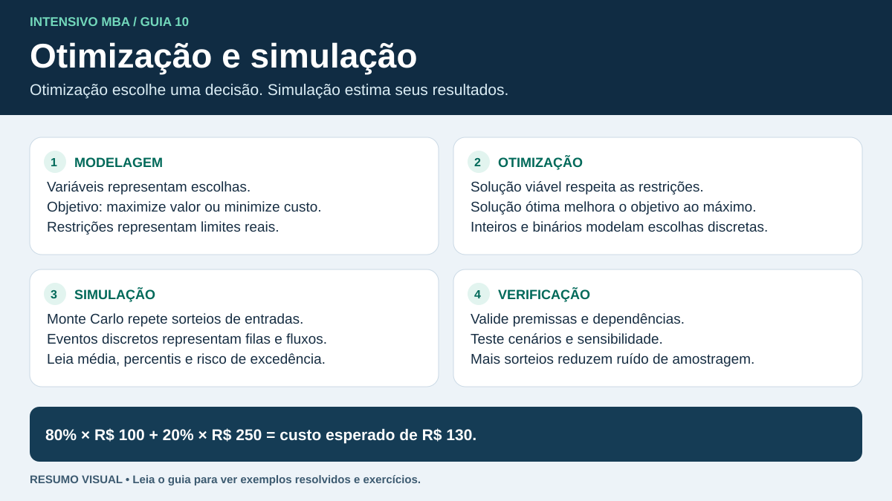

# Pesquisa operacional, otimização e simulação

A otimização escolhe **o que fazer** para melhorar um objetivo dentro de limites. A simulação estima **o que pode acontecer** sob uma decisão e um modelo de incerteza. Elas podem ser usadas juntas.

## Como modelar

1. **Decisão**. Defina o que você controla, como quantidade por rota ou escolha de instalar um centro.
2. **Objetivo**. Maximize margem ou minimize custo, tempo ou atraso. Declare a unidade.
3. **Restrições**. Traduza capacidade, demanda, orçamento e requisitos. Uma desigualdade no sentido errado muda o problema.
4. **Domínio**. Volume divisível pode ser contínuo. Número de veículos deve ser inteiro. Abrir ou fechar instalação pode ser binário.
5. **Solução**. Verifique viabilidade, valor objetivo e interpretação prática. Uma solução viável atende às restrições. Uma ótima é a melhor entre as viáveis.

Em programação linear, objetivo e restrições são lineares. Se há um ótimo finito e a região viável poligonal possui vértices, existe um ótimo em um vértice. Pode haver vários ótimos, inviabilidade ou objetivo ilimitado. Programação inteira mista admite variáveis discretas e contínuas. Arredondar um ótimo contínuo pode violar restrições ou perder a melhor solução inteira.

### Exemplo de produção e transporte

A operação escolhe lotes $x$ e $y$ que dão margens de 40 e 30. Resolva $\max 40x+30y$ sob $2x+y\le100$, $x+y\le70$ e $x,y\ge0$. Os vértices são (0,0), (50,0), (30,40) e (0,70). As margens são 0, 2000, 2400 e 2100. A solução ótima é (30,40), com ambas as restrições ativas.

Em um problema de transporte, use $x_{ij}$ como volume entre origem $i$ e destino $j$. Minimize $\sum c_{ij}x_{ij}$, limite cada soma de saída à oferta e garanta a demanda de cada destino. Em uma alocação um a um, a variável pode ser binária.

- **Folga** é quanto falta para atingir um limite de capacidade. No exemplo, em (20,30) sobram 30 unidades no primeiro limite e 20 no segundo.
- **Preço-sombra** mede a variação marginal do objetivo ótimo por unidade adicional do lado direito, dentro de uma faixa válida do modelo linear.
- **Sensibilidade** pergunta se a decisão muda quando custos, margens ou capacidades mudam. Ela depende do modelo e de seus intervalos.

## Simulação

- **Monte Carlo** amostra entradas aleatórias, calcula saídas e repete. Compare média, percentis e frequência de exceder um limite.
- **Eventos discretos** atualiza o estado quando há chegada, início ou fim de atendimento. Use para filas, docas e gargalos. Observe utilização, espera e nível de serviço.
- **Cenários** comparam hipóteses explícitas. Em Monte Carlo, inclua dependências relevantes entre entradas. Compare cenários com repetições, seed registrada e incerteza das estimativas.
- Separe **verificação** (o modelo foi implementado como planejado?) de **validação** (representa bem o problema de interesse?). Aumentar o número de simulações reduz ruído de amostragem, mas não corrige premissas ruins.

**Exemplo.** Se 80% das viagens custam R$ 100 e 20% custam R$ 250, o custo esperado é R$ 130. Em 1.000 repetições pode haver 217 viagens caras. A média simulada seria R$ 132,55 e a frequência acima de R$ 200 seria 21,7%. Uma média baixa pode esconder risco de cauda. Para simulações independentes, o erro-padrão da média estimada é $s/\sqrt{n}$.

Treino rápido

Se a capacidade $x+y\le70$ cair para 60, a interseção de $2x+y=100$ com $x+y=60$ passa a (40,20). Compare com (50,0), (0,60) e a origem. A maior margem é 2200 em (40,20).

## Relaxação inteira, Solver e transbordo

Na relaxação linear, variáveis inteiras passam a admitir frações. Em maximização, seu ótimo dá um limite superior para o valor inteiro. Em minimização, dá um limite inferior. Se o ótimo da relaxação já satisfaz todos os domínios do problema original, ele também é ótimo no problema inteiro. O método *branch and bound* divide o problema em casos e usa esses limites para descartar ramos que não podem melhorar a melhor solução viável.

Em uma planilha, separe células de decisão, célula do objetivo e fórmulas do lado esquerdo das restrições. Configure Solver com objetivo, sentido, células variáveis, limites e domínios. Confira a mensagem de solução, o objetivo e a viabilidade antes de interpretar o resultado.

Para ativar um terminal de transbordo, defina uma variável binária y. Com capacidade 50, imponha entrada ≤ 50y e entrada = saída no terminal. Inclua o custo fixo de abertura multiplicado por y no objetivo. Se y = 0, não há fluxo. Se y = 1, o terminal pode processar até 50 unidades. Os fluxos continuam sujeitos a oferta na origem e demanda no destino.

**Referência do curso**

Pesquisa Operacional e Modelos de Otimização III, 21/08/2026. Material de slides consultado para otimização inteira, Solver, transporte e transbordo.
