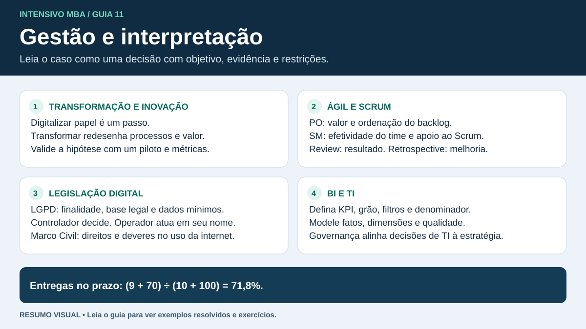

# Gestão em Data Science e Analytics

Este bloco treina interpretação de casos. Leia o comando, identifique a decisão e a restrição do texto, e elimine opções que prometem efeitos que o caso não sustenta.

## Transformação digital

| Conceito | Aplicação em logística |
|---|---|
| Digitização | Converter comprovantes em papel em arquivos digitais. |
| Digitalização de processos | Capturar, validar e encaminhar os comprovantes em um fluxo automatizado. |
| Transformação digital | Redesenhar a experiência de acompanhamento e faturamento com dados integrados, novas responsabilidades e métricas. |

Associe tecnologia a uma hipótese de valor. Exemplo: prova de entrega em tempo real pode reduzir o intervalo até faturamento. Defina linha de base, experimente em rotas comparáveis, acompanhe qualidade do dado, adesão e custo. Uma queda no prazo após a implantação é um sinal. Para atribuir efeito, examine outras mudanças, como sazonalidade e composição de clientes.

## Ágil e Scrum

O ciclo ágil trabalha em incrementos pequenos com feedback, mudança de prioridade e aprendizado. Um MVP testa uma hipótese de valor com esforço proporcional. Kanban torna o fluxo visível e limita trabalho em progresso. Em contexto complexo, experimentos pequenos ajudam a descobrir o que funciona.

- **Product Owner** responde pelo valor do produto e pela gestão efetiva do Product Backlog, incluindo sua ordenação.
- **Scrum Master** ajuda o time e a organização a aplicar Scrum e melhora a efetividade do Scrum Team.
- **Developers** planejam o trabalho da Sprint e criam um incremento utilizável que atende à Definition of Done.
- **Sprint Planning** estabelece por que a Sprint vale a pena, o que será feito e como o trabalho é planejado. **Daily Scrum** inspeciona progresso rumo ao objetivo da Sprint. **Review** examina o resultado com stakeholders e adapta os próximos passos. **Retrospective** melhora qualidade e efetividade do trabalho.
- **Product Backlog ↔ Product Goal**. **Sprint Backlog ↔ Sprint Goal**. **Incremento ↔ Definition of Done**.

Se o cliente mudou a prioridade do produto, procure o Product Owner. Se a questão trata de como o time pode reduzir falhas recorrentes de passagem de trabalho, pense em Retrospective. [Scrum Guide](https://scrumguides.org/scrum-guide.html)

## Legislação digital

A LGPD trata do tratamento de dados pessoais. O Marco Civil estabelece princípios, garantias, direitos e deveres relativos ao uso da internet no Brasil. No caso de LGPD, pergunte se há pessoa identificada ou identificável, qual é a finalidade, qual base se aplica e quais dados são necessários.

- **Controlador** toma as decisões sobre o tratamento. **Operador** atua em nome do controlador. **Encarregado** serve de canal de comunicação conforme o regime aplicável.
- Finalidade, adequação, necessidade, transparência, segurança e não discriminação são princípios úteis para interpretar casos. Uma base legal deve ser definida para a situação. Consentimento é uma das bases. Dados sensíveis têm regime próprio.
- O titular pode solicitar, conforme o caso, confirmação de tratamento, acesso e correção. A LGPD também prevê solicitação de revisão de decisões tomadas unicamente com base em tratamento automatizado de dados pessoais que afetem seus interesses.
- Pseudonimização troca identificadores por códigos ou outros meios. Se a pessoa ainda pode ser vinculada, o risco de identificação permanece. Limite acesso e retenção conforme a finalidade e as obrigações aplicáveis.

[LGPD atualizada, Câmara dos Deputados](https://www2.camara.leg.br/legin/fed/lei/2018/lei-13709-14-agosto-2018-787077-normaatualizada-pl.html) · [Marco Civil da Internet, Planalto](https://www.planalto.gov.br/ccivil_03/_ato2011-2014/2014/lei/l12965.htm)

## Business Intelligence

O fluxo começa com fonte e qualidade, segue para ETL/ELT, modelo de dados e métricas, e termina em ação. **Fato** registra evento ou medida no grão definido. **Dimensão** descreve data, cliente, rota ou produto. Uma dimensão com chave repetida pode multiplicar linhas e inflar somas. Em BI, defina filtro, período, numerador, denominador, unidade e proprietário de cada KPI.

**Exemplo.** A filial A entregou 9 de 10 no prazo. B entregou 70 de 100. O indicador global é $79/110=71{,}8\%$. A média simples de 90% e 70% seria 80% e daria o mesmo peso às duas filiais. Para decisão, separe visão global de visão por filial. Use linha para tendência, barras para comparar categorias e distribuição para investigar dispersão.

## TI e inovação

- **Governança de TI** liga investimento, controles e riscos à estratégia. **Gestão de TI** executa e monitora serviços, projetos e recursos.
- **Inovação de processo** altera como a operação entrega valor. **Inovação de produto ou serviço** muda o que ela oferece. Mudanças incrementais e de maior alcance podem coexistir.
- Compare soluções por custo total, integração, confiabilidade, segurança, adesão e capacidade de medir resultado. Teste hipóteses com piloto, indicadores de sucesso, responsável e critério de expansão.
- Para dados e modelos, considere acesso por papel, qualidade, linhagem, monitoramento de desempenho, deriva e revisão humana onde a decisão exigir.

Caso para responder antes de abrir

Um painel de atrasos será criado em piloto. A empresa quer usar a localização de todos os motoristas fora do horário por conveniência. Qual a sequência coerente?

Definir o KPI e seu grão, limitar a coleta ao necessário para o objetivo, validar a base legal e a transparência com as áreas responsáveis, testar o fluxo no piloto e revisar o incremento com os usuários.

